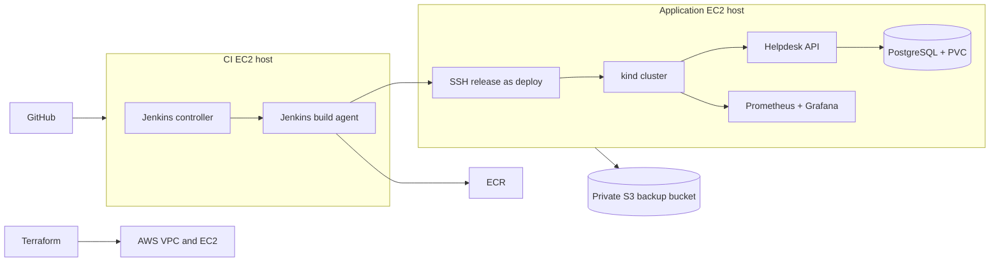

# RT Helpdesk DevOps final project

A supplied Flask + PostgreSQL application for Real Time College. Students operate and deploy this app. **No Python, frontend or business-logic coding is required.**

Read [the final project assignment](docs/Final_Project_Brief.docx) first. It covers AWS, Terraform, Kubernetes, Docker, Jenkins, Git, GitHub Actions, Linux, Prometheus and Grafana.

## What is included

| Included and ready to use | Built by students during the project |
|---|---|
| Flask API, browser UI and PostgreSQL schema | AWS infrastructure in Terraform |
| Five fictional tickets and automated tests | Linux server configuration and automation |
| Container packaging brief, Dockerfile, .dockerignore and local Compose environment | Container build, runtime verification and test execution |
| Kubernetes and database initialization examples | Kubernetes manifests and environment configuration |
| Example GitHub Actions checks | Jenkins release and deployment pipeline |
| App metrics, Prometheus rules and Grafana dashboard | Kubernetes monitoring deployment and failure evidence |
| Local and Kubernetes backup helpers | S3 backup and restore verified against the EC2-hosted kind deployment |

This is an individual project targeting 70-90 hours, with one application namespace (`helpdesk`) plus monitoring. Bash/cloud-init cover server setup; Ansible is not required. The [reference solution and setup guide](reference/README.md) supply templates for the supported beginner path. Students use their own AWS accounts and available AWS credits, configure their own Jenkins agents and deployment credentials, connect the pipeline and verify each required outcome. The instructor supplies tested templates and guidance. The schedule allocates 74 planned hours plus up to 16 troubleshooting hours.

The Terraform configuration in `infrastructure/` describes the two-host AWS deployment and includes declarations to adopt existing AWS resources. On 25 November 2026, a refreshed Terraform plan completed with no proposed changes; no apply was performed. That result is a historical verification of the configuration and state at that time. Subsequent local, uncommitted adoption/import edits in the active root have not been applied or independently revalidated. The declarations alone do not prove that resources have been imported into Terraform state.

## Container packaging

The multi-stage `Dockerfile` and `.dockerignore` are included. The image provides separate test and runtime targets, runs as non-root UID/GID 10001, and supports a read-only root filesystem with writable `/tmp`.

See [CONTAINER_PACKAGING.md](docs/CONTAINER_PACKAGING.md) for the packaging requirements and verification procedure. The test target was built locally and the test suite completed with 36 passed tests. The successful App CI run also confirms a runtime-target build. The default image target and all runtime acceptance checks in the packaging assignment are not fully evidenced; see `docs/VALIDATION.md`.

## Start locally

After completing the container packaging checks, use the following steps.

Requirements: Docker Engine or Docker Desktop with Compose v2, Git, and Python 3.10+ for the helper scripts. Docker Desktop on Windows should use Linux containers. Run all commands from this folder. On Windows, use `py` if `python` is not available.

```sh
python scripts/setup_env.py
docker compose up --build -d
docker compose exec api flask --app app seed-db
```

Open **http://localhost:8000**. Create a ticket and close or reopen it. No login is needed in this lab.

The setup script generates three random passwords in `.env`. It will not overwrite an existing file. Do not commit `.env`. PostgreSQL is reachable only inside the Compose network, and web ports bind to localhost. Use fictional data. Public access and user authentication are outside this lab's default setup.

Initial startup creates the non-superuser `helpdesk_app` role, its schema, and the tickets table. The `migrate` service is a one-shot initialization step. It must finish successfully before the API starts. API restarts do not clear tickets or recreate the schema.

Useful commands:

```sh
docker compose ps -a
docker compose logs --tail 100 api migrate db
docker compose restart api
docker compose down
```

`docker compose down` keeps the data volume. `docker compose down -v` deletes volumes and their contents; use it only when you intentionally want a fresh lab. Changing passwords in `.env` does not change passwords in an existing PostgreSQL volume. Keep the original passwords, rotate them in PostgreSQL, or reset an expendable lab volume.

## Add Prometheus and Grafana

```sh
docker compose --profile monitoring up --build -d
bash traffic.py
```

| Service | Local address |
|---|---|
| Helpdesk UI | http://localhost:8000 |
| App metrics | http://localhost:8000/metrics |
| Prometheus targets | http://localhost:9090/targets |
| Prometheus alerts | http://localhost:9090/alerts |
| Grafana | http://localhost:3000 |

Log into Grafana as `admin`, using `GRAFANA_ADMIN_PASSWORD` from `.env`. Open **Dashboards → DevOps Lab → RT Helpdesk**. The Prometheus datasource and dashboard are provisioned from files. Allow at least two scrapes for rates to appear. An error-rate panel showing zero with healthy traffic is expected.

Read [the monitoring lab](docs/MONITORING.md) for queries, alert exercises and Kubernetes requirements. Prometheus displays firing/resolved alerts. Email or chat notifications are not configured in this package.

## Tests

The following command uses a separate, disposable PostgreSQL test database. It does not test against the application's persistent database.

```sh
docker compose --profile test run --build --rm tests
docker compose --profile test stop test-db
docker compose --profile test rm -f test-db
```

For local Python development, install Python 3.12 and run:

```sh
python -m venv .venv
# Linux/macOS: source .venv/bin/activate
# Windows PowerShell: .venv\Scripts\Activate.ps1
python -m pip install -r requirements-dev.txt
python -m pytest -q
```

Without `RUN_DB_TESTS=1`, database integration tests explicitly skip. To run them against your own disposable PostgreSQL, set `DB_HOST`, `DB_PORT`, `DB_NAME`, `DB_USER`, `DB_PASSWORD`, `DB_SSLMODE` and `RUN_DB_TESTS=1`. `DB_NAME` must end in `_test`; these tests clear its tickets table. The test user must be able to create the `helpdesk` schema. Do not use a shared or live database.

`.github/workflows/ci.yml` runs all tests with a PostgreSQL service on pull requests and `main`. It also builds the runtime image without pushing it. Enable the workflow after pushing the repository to GitHub, then require its check where your repository supports that feature. Otherwise record successful checks before merging. No independent PR approval is required for this individual project. Actions use version tags for readability; pin reviewed commit SHAs for a stronger supply-chain policy.

## Backup and restore

The project has two distinct backup contexts. The local Compose environment and the Kubernetes deployment must not be treated as interchangeable.

The required Kubernetes backup workflow uses `reference/scripts/k8s-backup.sh`. It obtains a short-lived Kubernetes service-account token, runs `pg_dump` against the PostgreSQL pod, and uploads the custom-format dump to the S3 backup bucket. This workflow was verified against the EC2-hosted kind deployment. A PostgreSQL custom-format backup was restored into a separate disposable PostgreSQL 16 environment and its ticket records were inspected. The live database was not overwritten.

The live PostgreSQL persistence check also replaced the database pod while retaining its bound persistent volume; all six live ticket records and their fingerprint remained unchanged. The S3 restore contained five records from the earlier backup time; the live comparison had six because a later Jenkins smoke test created another ticket. The actual S3 download and disposable-database restore were re-verified; all five restored records matched the pre-backup records. See the [S3 restore verification evidence](evidence/local/s3-restore-verification.txt) for the terminal results.

A successful recovery check must restore a backup into a disposable PostgreSQL database and compare actual ticket values, not just confirm that the archive exists or can be listed. Never restore over the live database. Backup archives contain ticket data; keep them private.

## API and deployment contract

See [API.md](docs/API.md) for requests and configuration. All web responses use port **8000**. Required paths are `/healthz`, `/readyz`, `/version` and `/metrics`.

Your runtime image must include Gunicorn, use UID/GID **10001**, write application logs to stdout and support a read-only root filesystem with writable `/tmp`. **Keep one Gunicorn worker per container** for correct metrics. Four threads serve requests; scale with Kubernetes replicas. Adding worker processes requires Prometheus multiprocess configuration that is not included here.

Build an image with an identifiable version:

```sh
docker build --target runtime --build-arg APP_VERSION=demo-v1 -t rt-helpdesk:demo-v1 .
```

In Jenkins, use the exact checked-out Git commit SHA as the image version. The current pipeline validates the trusted `main` revision, runs the integration tests, builds the runtime image, publishes it to the private Amazon ECR repository and archives the immutable image digest.

The approved release was deployed to the application host: the pipeline validated the trusted `main` revision, passed all 36 tests, published the runtime image to ECR, archived its immutable digest, and completed the approved Kubernetes rollout and smoke checks. The release script's rollback behavior was separately demonstrated on 26 November 2026 in a disposable local kind cluster; this is not evidence of a Jenkins-triggered rollback or AWS rollback execution. No specific Jenkins rollback build or console evidence was independently identified among builds #1–#8. Do not cite Build #6 as proof of rollback. Do not treat image publication alone as a completed deployment. `APP_ENV` is runtime configuration; normally do not override baked-in `APP_VERSION` in Kubernetes.

Before starting the app in a new Kubernetes environment, provision the database and `helpdesk` schema, then run the image once as a Job with:

```sh
flask --app app init-db
```

The `init-db` command retries PostgreSQL operational errors up to ten times by default, waiting one second between attempts; the `--attempts` option allows a limit of 1–30 attempts. `schema.sql` is the initial schema, not a general migration framework. App restarts do not execute DDL.

## Versions and verification

Python dependencies are pinned in `requirements.txt` and `requirements-dev.txt`. PostgreSQL uses the maintained `16-bookworm` tag; Python uses `3.12-slim-bookworm`. These tags can receive updates. Record resolved digests in your release evidence. Prometheus and Grafana use explicit versions in Compose. Review and scan versions before running a class.

See [VALIDATION.md](docs/VALIDATION.md) for what was actually executed while preparing this package and what still requires a Docker/AWS environment.

### CI, monitoring and recovery evidence

- [CI evidence index](evidence/ci/README.md)
- [Successful App CI run](https://github.com/Avigdor-bit/rt-helpdesk/actions/runs/44917156684) — validation, tests and image build; not ECR publication or deployment.
- [Monitoring and recovery record](docs/MONITORING.md)
- [S3 backup restore verification](evidence/local/s3-restore-verification.txt)

## Deployment architecture



## AWS cleanup and resource retention

Do not run `terraform destroy` as a routine cleanup step. It can remove the project hosts and other managed infrastructure.

Before any teardown, review the Terraform plan and confirm which resources would be deleted. Preserve the Terraform state bucket and S3 backup bucket, including their contents and versions. Do not delete backups or state as part of ordinary project cleanup.

## Final self-study exercise (2–3 hours)

**Status: selected self-study task completed; duration not recorded.** The Linux resource-diagnosis task was completed on 26 November 2026 and documented in [Linux resource-diagnosis evidence](evidence/local/linux-resource-diagnosis.txt). It covers CPU, memory, swap, filesystem and inode diagnosis; safe storage investigation; approved cleanup; verification; and lessons learned. The report does not claim that the assigned 2–3-hour duration was completed. The separate Kubernetes troubleshooting exercise is additional supporting evidence.

The course brief requires one small self-study task. This project uses the Linux resource-diagnosis option; the Grafana-panel and alert-duration options were not selected.

Do not perform destructive tests against the live database or delete shared AWS resources.
